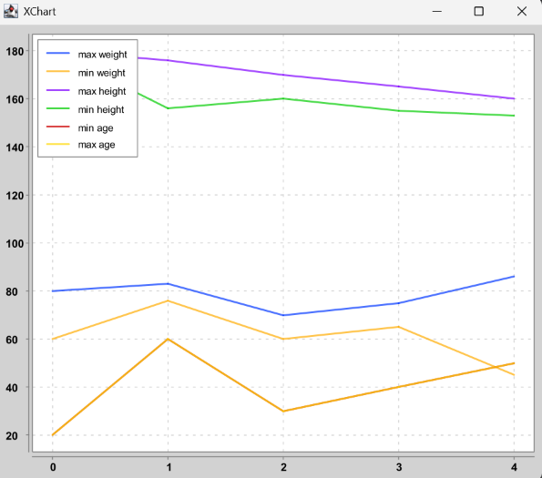

Lightweight library implementing Dataframe and Series objects for scientific and Data Science computations.

Supports the following operations:

- Creation of Dataframe and Series objects
- Collection of objects into a Dataframe or Series through the stream API
- Compute statistics
- Sorting rows
- Grouping rows
- Filtering rows
- Aggregating rows
- Group-Aggregate rows
- Plotting
- CSV serialization
- JSON serialization


```java
        List<Person> people = Arrays.asList(
        new Person(20, 180, 60),
        new Person(60, 156, 76),
        new Person(30, 160, 60),
        new Person(40, 155, 75),
        new Person(50, 153, 86),
        new Person(20, 180, 80),
        new Person(40, 165, 65),
        new Person(50, 160, 45),
        new Person(30, 170, 70),
        new Person(60, 176, 83)
);


// ---- Series ----

Series peopleAge = people.stream().collect(Series.collector(Person::getAge));

// ---- Statistics ----

double averageAge = peopleAge.average();
double minAge = peopleAge.min();
double maxAge = peopleAge.max();


// ---- Dataframe ----

Dataframe df = people.stream()
        .collect(
                Dataframe.<Person>collector()
                        .addColumn(HEIGHT, Person::getHeight)
                        .addColumn(WEIGHT, Person::getWeight)
                        .addColumn(AGE, Person::getAge)
        );

        df.printStatistics();


// ---- Sorting ----

Dataframe sortedDataframe = df.sort(true, Sorter.sortByColumn(AGE, age -> age));

Dataframe shuffledDataframe = df.sort(true, Sorter.shuffle());


// ---- Grouping ----

Map<Object, Dataframe> groupedByAge = df.group(Grouper.groupByColumnValues(AGE));

Map<Object, Dataframe> splits = df.group(Grouper.split(3));


// ---- Filtering ----

Dataframe head = df.filter(Filter.head(2));
Dataframe between = df.filter(Filter.between(3, 4));
Dataframe tail = df.filter(Filter.tail(2));

Dataframe filteredByAge = df.filter(Filter.rowTest(row -> row.get(AGE) >= 30));


// ---- Aggregation ----

// Aggregates columns "weight", "height" and "age" into their min and max values
Aggregator aggregator = new Aggregator()
        .addAggregation("max weight", df0 -> df0.getColumn(WEIGHT).max())
        .addAggregation("min weight", df0 -> df0.getColumn(WEIGHT).min())
        .addAggregation("max height", df0 -> df0.getColumn(HEIGHT).max())
        .addAggregation("min height", df0 -> df0.getColumn(HEIGHT).min())
        .addAggregation("min age", df0 -> df0.getColumn(AGE).min())
        .addAggregation("max age", df0 -> df0.getColumn(AGE).max());

// Groups by age and applies the aggregator to each group
Dataframe groupByAgeAggregated = df.groupAggregate(
        Grouper.groupByColumnValues(AGE),
        aggregator
);


// ---- Plotting ----

Plotter.line(groupByAgeAggregated);


// ---- CSV Serialization ----

String csv = Serializer.toCsv(true, df);

Dataframe fromCsv = Serializer.fromCsv(true, csv);

// ---- JSON Serialization ----

String json = Serializer.toJson(JsonFormat.COLUMNS_ROWS, df);

Dataframe reconstructed = Serializer.fromJson(JsonFormat.COLUMNS_ROWS, json);
```


